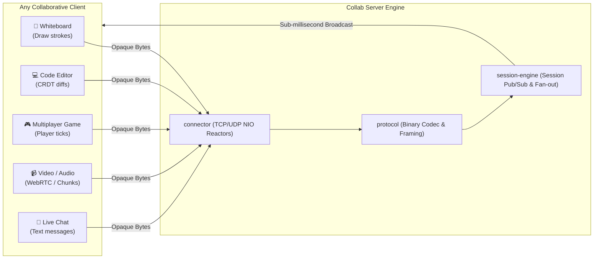

# Collab Server

**Collab Server** is a high-performance, ultra-low-latency, **domain-agnostic** real-time collaboration engine written in Java 26 using Java NIO (Non-blocking I/O).

It functions as a universal session-based routing and pub/sub engine, engineered to power **any real-time collaborative application**—including **collaborative whiteboards, co-editing code editors, multiplayer games, live chat, and audio/video calling streaming/signaling**.

---

## 🎯 Universal & Domain-Agnostic Design

The server is **application-agnostic**:
* **Opaque Payloads (`byte[]`)**: The server does not inspect or care about domain business models (drawing vectors, CRDT operations, player coordinates, or audio/video streams). Clients serialize and deserialize their own schemas.
* **Low-Latency Session Fan-Out**: The server focuses entirely on high-speed session/room routing, subscriber management, and multi-client broadcasting.
* **Large Packet & Media Chunking**: Video calls, large canvas snapshots, and file transfers are supported through streaming chunk fragments (`chunkIndex`/`totalChunks`). The server relays chunks immediately at wire speed with **zero reassembly delay and near-zero memory footprint**.



---

## 🌟 Key Features

* **Hybrid Dual Transport (TCP + UDP)**:
  * **TCP**: Reliable, ordered transport for state updates, document sync, and chat.
  * **UDP**: Fast, loss-tolerant transport for live mouse pointers, streaming, and player coordinates.
* **Zero-Allocation Inbound Processing**:
  * Reusable 64 KB off-heap direct `ByteBuffer` across channel reads on selector threads to eliminate GC overhead.
* **Length-Prefixed Framing & Binary Codec**:
  * Length-prefixed framing for TCP streams and a compact binary envelope with magic byte integrity checks.
* **Dedicated High-Performance Reactors**:
  * Dedicated TCP reactor loop ([`TCPInboundTrafficSelector`](file:///C:/Users/donfa/Desktop/collab-server/collab-server/connector/src/main/java/com/anilyanai/connector/selector/TCPInboundTrafficSelector.java)).
  * Dedicated wire-speed UDP reactor loop ([`UDPInboundTrafficSelector`](file:///C:/Users/donfa/Desktop/collab-server/collab-server/connector/src/main/java/com/anilyanai/connector/selector/UDPInboundTrafficSelector.java)).
  * Multi-reactor outbound drain array in [`OutboundTrafficSelector`](file:///C:/Users/donfa/Desktop/collab-server/collab-server/connector/src/main/java/com/anilyanai/connector/selector/OutboundTrafficSelector.java).
* **Decoupled Architecture**:
  * Clean separation across transport (`connector`), wire protocol (`protocol`), session routing, and application layers.

---

## 🏗️ Multi-Module Architecture

```
collab-server/
├── pom.xml                               # Parent Maven POM
├── connector/                            # Transport & Non-blocking NIO Engine
│   ├── README.md                         # Connector architecture documentation
│   └── src/main/java/com/anilyanai/connector/
│       ├── ConnectionManager.java        # Main facade for starting transport & dispatch
│       ├── selector/
│       │   ├── TCPInboundTrafficSelector.java # Dedicated TCP inbound reactor
│       │   ├── UDPInboundTrafficSelector.java # Dedicated UDP wire-speed reactor
│       │   ├── OutboundTrafficSelector.java   # Multi-reactor outbound write array
│       │   └── InboundPeerTrafficSelector.java # Cluster peer mesh transport
│       ├── connection/
│       │   ├── TCPConnection.java        # TCP channel & frame extractor
│       │   └── UDPConnection.java        # UDP direct atomic datagram transport
│       └── registry/
│           └── ConnectionRegistry.java   # Active connection tracking
│
├── protocol/                             # Universal Binary Protocol & Codecs
│   ├── README.md                         # Protocol envelope & opcode documentation
│   └── src/main/java/com/anilyanai/protocol/
│       ├── Opcode.java                   # JOIN, LEAVE, BROADCAST, DIRECT, PING
│       ├── Packet.java                   # Universal immutable message model
│       └── codec/
│           └── BinaryPacketCodec.java    # High-speed ByteBuffer encoder/decoder
│
├── session-engine/                       # Room session state & routing
│   └── src/main/java/com/anilyanai/engine/
│       ├── session/                      # SessionRegistry & Room lifecycle
│       └── state/                        # State preservation & sync
│
├── collab-business/                      # Packet dispatching & security authorization
│   └── src/main/java/com/anilyanai/business/
│       ├── dispatcher/                   # High-speed packet routing
│       └── security/                     # HMAC-SHA256 token verification
│
├── collab-application/                   # Spring Boot entry point & server runner
│   └── src/main/java/com/anilyanai/application/
│       ├── CollabServerMain.java
│       └── runner/
│           └── CollabServerRunner.java
│
└── testAndLearning/                      # Concurrency & latency benchmark suites
    └── src/main/java/com/anilyanai/testserversingleroomgroupchat/
        └── HybridGroupChatBenchmark.java # Full-duplex concurrent benchmark
```

---

## 🚀 Getting Started

### Prerequisites
* Java 21+ (Java 26 recommended)
* Maven 3.9+

### Build
```bash
mvn clean install
```

### Run the Server
```bash
cd collab-application
mvn spring-boot:run
```

### Run Concurrency Benchmarks
To run the high-concurrency hybrid benchmark:
```bash
mvn test-compile exec:java -pl testAndLearning -Dexec.mainClass="com.anilyanai.testserversingleroomgroupchat.HybridGroupChatBenchmark"
```
