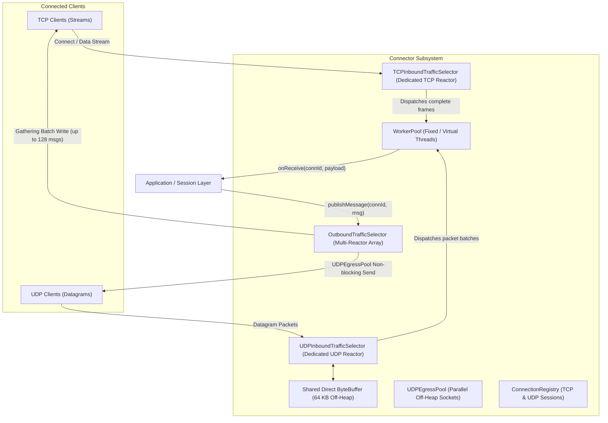

# Connector Module (`connector`)

The **`connector`** module is a high-performance Java NIO (Non-blocking I/O) networking layer engineered for real-time, low-latency, high-throughput collaboration servers. It provides dual-transport support (**TCP** and **UDP**) with zero-allocation buffer reuse, isolated inbound reactors, and lock-free thread dispatching.

---

## 🏛️ Architecture Overview



---

## 🔍 Inbound Reactors Deep Dive

### 1. TCPInboundTrafficSelector
File: [`TCPInboundTrafficSelector.java`](file:///C:/Users/donfa/Desktop/collab-server/collab-server/connector/src/main/java/com/anilyanai/connector/selector/TCPInboundTrafficSelector.java)

The `TCPInboundTrafficSelector` runs on a dedicated thread (`"tcp-inbound-selector"`) focused exclusively on TCP connection management:
* **TCP Connection Acceptance**: Accepts client connections from `ServerSocketChannel`, configures `TCP_NODELAY`, pre-registers with the outbound reactor array, and attaches a `TCPConnection`.
* **Zero-Allocation Framing**: Extracts complete frames using 4-byte length headers and dispatches them in batches to the worker pool.
* **TCP RST / Disconnect Cleanup**: Detects FIN/RST drops instantly, notifies disconnect listeners, cancels selection keys, and frees resources.

### 2. UDPInboundTrafficSelector
File: [`UDPInboundTrafficSelector.java`](file:///C:/Users/donfa/Desktop/collab-server/collab-server/connector/src/main/java/com/anilyanai/connector/selector/UDPInboundTrafficSelector.java)

The `UDPInboundTrafficSelector` runs on a dedicated thread (`"udp-inbound-selector"`) for line-rate datagram ingestion:
* **Dedicated Channel**: Operates directly on the inbound `DatagramChannel` without selection key iteration overhead.
* **Zero-Allocation Direct Buffer**: Uses a 64 KB off-heap direct buffer for zero-copy kernel socket draining.
* **Micro-Batch Dispatching**: Flushes datagrams in batches directly to the worker pool, minimizing lock contention.

---

## ⚙️ Configuration Properties

Configured in `application.properties`:

| Property | Default | Description |
|---|---|---|
| `collab.connector.tcp-enabled` | `true` | Enables TCP transport |
| `collab.connector.tcp-port` | `8080` | Port for TCP listening |
| `collab.connector.udp-enabled` | `true` | Enables UDP transport |
| `collab.connector.udp-port` | `8080` | Port for UDP listening |
| `collab.connector.inbound-worker-threads` | `6` | Inbound worker pool threads |
| `collab.connector.outbound-selectors` | `2` | Multi-reactor outbound selector threads |
| `collab.connector.tcp-send-buffer-size` | `131072` | TCP socket send buffer (128 KB) |
| `collab.connector.tcp-receive-buffer-size` | `131072` | TCP socket receive buffer (128 KB) |
| `collab.connector.udp-egress-channels` | `64` | Parallel UDP egress socket pool size |

---

## 🚀 Usage Example

```java
@Autowired
private ConnectionManager connectionManager;

public void startServer() throws Exception {
    connectionManager.start(
        // Inbound client handler callback
        (connectionId, payloadBytes) -> {
            log.info("Received {} bytes from {}", payloadBytes.length, connectionId);
        },
        // Peer cluster handler callback
        (peerConnectionId, payloadBytes) -> {
            log.info("Cluster peer message received from {}", peerConnectionId);
        },
        // Outbound handler callback
        (connectionId, messageObject) -> {
            return serializeToBytes(messageObject);
        }
    );
}
```
